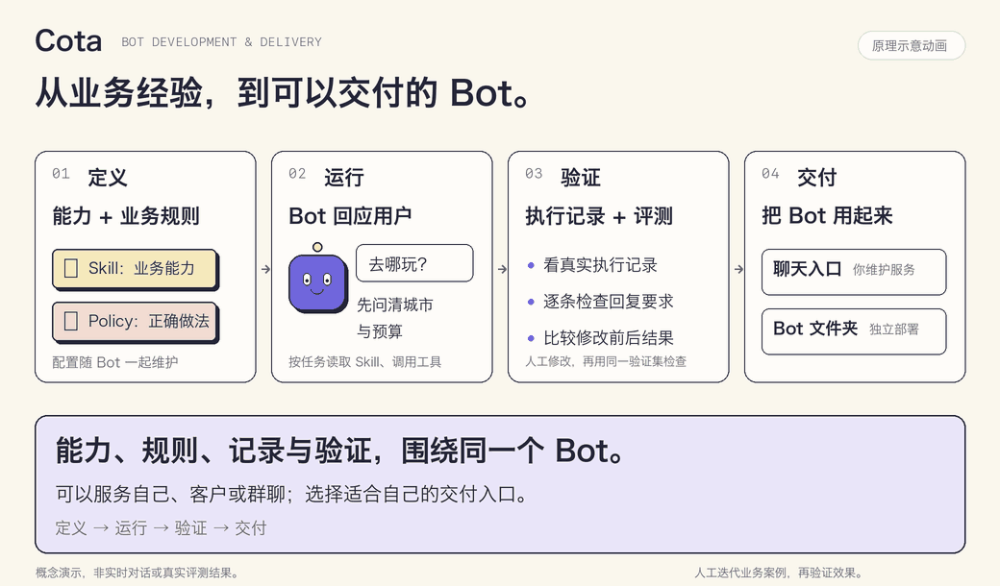

<div align="center">

<h1>Cota</h1>

<p><strong>Bot 开发与部署平台</strong></p>
<p>面向开发者和 Bot 创作者的开发与部署平台，让不具备深厚 Agent 工程经验的人，也能将模型、Skill 和业务规则组合成可靠、可维护、可持续优化的 Bot，并通过服务入口或机器人包交付给自己或他人使用。</p>

<p>
  <a href="#快速开始">开始第一个 Bot</a> ·
  <a href="https://cotaai.github.io/cota/">项目主页</a> ·
  <a href="docs/src/introduction.md">使用文档</a> ·
  <a href="bots/weather/README.md">weather 示例</a>
</p>

<picture>
  <source media="(prefers-reduced-motion: reduce)" srcset="https://raw.githubusercontent.com/CotaAI/cota/main/docs/assets/readme/cota-workflow.png">
  
</picture>

<p><sub>原理示意动画，非实时运行或实际评测结果。<a href="https://raw.githubusercontent.com/CotaAI/cota/main/docs/assets/readme/cota-workflow.png">查看静态图</a></sub></p>

</div>

## 为什么需要 Cota？

让模型回答一次问题之后，还需要把业务做法、执行过程和使用入口组织起来，机器人才能长期使用。

- **把业务经验写下来。**什么时候先问一句，什么时候查数据，遇到异常怎么处理，用业务案例指导 Bot。
- **让改进有依据。**看真实对话和工具记录，用同一份验证集对比修改前后的结果。
- **把成果交付出去。**维护一个聊天服务，或把角色、能力、规则、配置和验证案例放进 Bot 文件夹交付。

Cota 面向懂业务、愿意编辑 YAML / Markdown 并维护运行环境的开发者。个人助手、客服和群聊助手是它的使用场景；**完整的 Bot 是交付单位**。

## 快速开始

### 1. 安装并初始化

需要 Python 3.12+。在准备好的 Python 环境中安装已发布版本：

```bash
uv pip install -U cota
cota init
cd cota_projects/weather
```

`cota init` 创建官方示例目录，并保留已有的同名 Bot。使用飞书可安装 `cota[feishu]`。带内置运行时的平台 wheel 包含固定版本 Node/Pi；具体要求见 [安装说明](docs/src/installation/install.md)。

<details>
<summary>没有 uv？用 pip 也可以</summary>

```bash
python -m pip install -U cota
```

推荐安装 [uv](https://docs.astral.sh/uv/)，它的安装速度比 pip 快 10–20 倍。

</details>

<details>
<summary>从源码开发或使用仓库最新代码</summary>

另外准备 Node.js 22.19+ 和 npm；固定 Node 版本见 `.node-version`。

```bash
git clone https://github.com/CotaAI/cota.git
cd cota
uv venv --python 3.12
source .venv/bin/activate
uv pip install -e '.[dev]'
npm ci --prefix cota/runtime/pi
cota init
cd cota_projects/weather
```

</details>

### 2. 配置模型

编辑 Bot 的 `endpoints.yml`，填写支持工具调用的模型服务，并保留模板中的 SQLite 配置：

```yaml
llms:
  default:
    type: openai
    key: "填写模型服务密钥"
    apibase: "填写兼容 Chat Completions 的 API 地址"
    model: "填写支持工具调用的模型名称"
```

### 3. 开始对话，看清它怎么做

```bash
cota shell --debug
```

试着连续问两轮：

> 杭州，两大一小，今天想找室内亲子活动，门票总预算三百。
>
> 预算改成一百，其他条件不变。

终端会输出本地 Debug 页面地址，可以查看 Events、Skill 与工具目录、模型请求、DST 和投递状态。

输入 `/stop` 退出 Shell，再在 Bot 目录评测：

```bash
cota eval
```

weather 自带 **30 个对话评测案例**，覆盖多轮条件变更、预算约束、业务回复和异常处理。天气查询使用外部接口，活动查询使用随示例提供的活动目录，便于复现验证。详见 [weather 示例](bots/weather/README.md)。

想验证更长的制作流程，可以使用 [绘本工坊](bots/picture-book/README.md)：组合故事与分镜、图像生成/编辑、视觉审校和中文 PDF，并通过配套 Web 应用下载成品。它使用默认 machine 环境，需要自行配置图像/视觉服务及可选排版依赖。

对话支持[文件附件](docs/src/concepts/attachments.md)：Shell 用 `/file "路径"` 添加文件，Web 支持上传和授权下载；两者沿用统一的会话与历史链路。machine 环境的 Bot 可交付工作区中的报告、图片或 PDF，文件内容独立于事件数据库保存。

需要浏览器聊天入口时，在 Bot 目录启动：

```bash
cota run --chat-app --host 127.0.0.1 --port 5005
```

打开 `http://127.0.0.1:5005/chat/`。对外提供服务前，按 [部署指南](docs/src/deployment/guide.md) 配置访问入口与授权。

## Cota 如何把一个 Bot 做完整？

### 定义：能力与正确做法一起维护

```text
my-bot/
├── agent.yml                 # 角色、行为、工具权限与 Policy 策略
├── endpoints.yml             # 模型、存储与 Channel 配置
├── skills/                   # 业务能力说明、SOP 与资源
└── policy/
    ├── data.yml              # 业务案例：教 Bot 怎样做
    └── eval/data.yml         # 验证案例：检查它是否做到
```

**Skill 描述“能做什么”，Policy 指导“这时候怎样做”。**模型结合当前对话和真实执行结果选择、组合能力。

例如，天气服务没有返回有效数据时，期望 Bot 说明情况。在 `policy/data.yml` 写下：

```yaml
policies:
  - name: 天气查询失败时说明情况
    steps:
      - user: 北京现在多少度？
      - bot:
          - skills: [weather]
          - result: 主服务与备用服务都没有返回有效天气数据。
          - reply: 暂时没查到北京的气温，稍后再试一下吧。
```

`result` 描述案例适用的结果条件；运行时仍以本次实际数据为准。你可以直接编写案例，也可以用 `cota annotate export` 导出真实对话草稿，人工修改后通过 `cota annotate import` 校验。

案例较多时，可选择 BM25、Embedding 或模型策略，并按需用 `cota train` 准备索引等产物。运行时结合当前对话与执行事实，在每次模型请求前选取适用指导。使用方法见 [业务标注](docs/src/concepts/skill-policy.md) 与 [Policy 训练和推理](docs/src/concepts/trainable-policy.md)。

### 验证：按业务要求逐项检查

在 `policy/eval/data.yml` 用相近的对话格式写要求：

```yaml
policies:
  - name: 缺少查询城市
    steps:
      - user: 帮我查一下天气
      - bot:
          reply-review:
            - 询问用户要查询的城市。
            - 不擅自选择城市，也不编造天气数据。
```

`cota eval` 运行 Bot，再用 LLM 按回复要求逐项评判，输出进度、评分、报告和结构化执行证据。验证要求不会提供给被测 Bot；评委优先使用 `llms.evaluator`，未配置时使用默认模型。

改进流程是：

```text
查看真实记录 → 人工修改 Skill / Policy → 按需训练 → 用同一验证集评测 → 比较版本
```

`cota eval judge` 可以重评已有执行记录，`cota eval compare` 可以比较多次评测。LLM 评委可能误判，关键业务结果仍需复核。完整用法见 [对话评测](docs/src/development/evaluation.md) 和 [Debug](docs/src/deployment/debug.md)。

### 交付：聊天入口，或 Bot 文件夹

| 交付方式 | 使用者得到什么 | 谁维护运行环境 |
| --- | --- | --- |
| 分享已有服务 | 网页、IM 或已有应用中的聊天入口 | 服务维护者 |
| 分享 Bot 文件夹 | 配置、Skill、Policy、验证案例及所需资源 | 接收方安装 Cota、准备凭据与业务依赖，独立部署 |

业务规则和验证案例可以随 Bot 一起交付、持续更新。具体准备工作见 [交付与分享](docs/src/deployment/sharing.md)。

## 选择你的使用方式

| 你要做什么 | Cota 的支持 | 从这里开始 |
| --- | --- | --- |
| 自己长期使用的助手 | 本机或自用云主机运行，保留对话与个人记忆，按配置使用部署环境工具 | [Agent 与部署模式](docs/src/configuration/agent.md) |
| 客服或业务助手 | 对接业务接口，按会话保存历史、去重和排队，跨会话有限并发 | [Application 接入](docs/src/deployment/application.md) |
| 团队或社群助手 | 被 @ 时回应，也可启用主动参与判断，使用带说话者身份的群聊上下文 | [群聊模式](docs/src/deployment/group.md) |
| 自有网页或小程序 | HTTP/WebSocket 接入，可选聊天页面提供会话列表、历史分页和未读状态 | [Web 接入](docs/src/deployment/api.md) · [配套聊天应用](docs/src/deployment/chat-app.md) |
| 飞书或公司内部 IM | 内置飞书；其它平台以独立 Channel 包安装、配置，复用生命周期与投递机制 | [飞书](docs/src/deployment/feishu.md) · [自定义 Channel](docs/src/development/channel-plugins.md) |

身份认证、会话归属和成员授权由外围应用或平台适配器完成。Cota 负责已验证输入的执行协调、记录和回复投递。

## 常见问题

<details>
<summary><strong>Cota 提供托管平台或可视化搭建吗？</strong></summary>

当前提供文件配置、命令行和自行部署的工作流。创作者分享聊天入口时维护服务，分享文件夹时由接收方独立部署。托管云平台与可视化拖拽搭建不在当前交付范围内。

</details>

<details>
<summary><strong>自用助手和多人服务的工具权限怎么区分？</strong></summary>

默认使用全部能力（`environment.type: machine`）。不需要原生文件与 Shell 的 Bot 显式设 `environment: {type: none}`。对外提供服务时，通过 sandbox 隔离执行环境。工作目录不构成安全沙箱。权限与执行环境见 [工具接入](docs/src/concepts/tool-adapters.md)。

</details>

<details>
<summary><strong>Cota 和 Pi 分别负责什么？</strong></summary>

官方 TypeScript Pi Agent Core 驱动模型—工具循环。Cota 负责 Bot 定义、Policy 指导、应用接入、持久化、交付与验证。DST 根据事件恢复状态，Store 保存事件与快照，Trace 用于回溯执行证据。详见 [模块地图](docs/src/concepts/modules.md) 与 [执行流程](docs/src/concepts/execution-flow.md)。

</details>

<details>
<summary><strong>可以自动优化 Bot 吗？</strong></summary>

当前支持记录、业务标注、Policy 训练、对话评测与版本比较，由开发者据此更新 Bot。自动生成优化版本并验证、应用的 RSI 流程仍是后续方向。

</details>

<details>
<summary><strong>可以开多个进程共同执行同一个 Bot 吗？</strong></summary>

当前执行协调以单进程为边界。同一 Bot 的数据库使用一个执行进程；SQL revision 不能替代跨进程执行租约，也不能撤销已发生的外部副作用。部署方式见 [部署指南](docs/src/deployment/guide.md)。

</details>

## 文档与开发

- [使用手册](docs/src/introduction.md)：按目标选择阅读路线。
- [配置参考](docs/src/configuration/overview.md)：Agent、模型、存储与 Policy。
- [Skill](docs/src/skills/overview.md) · [工具](docs/src/concepts/tool-adapters.md) · [自定义 Channel](docs/src/development/channel-plugins.md)：扩展业务能力和平台入口。
- [测试指南](tests/README.md) · [能力边界与规划](docs/src/concepts/roadmap.md) · [2.0 更新](docs/releases/2.0.0.md)。

从源码开发时运行：

```bash
python scripts/check.py --coverage
```

检查语法、静态规则、Python/JavaScript 回归与覆盖率。框架测试使用可控模型响应；业务效果使用自己的验证集和模型服务评测。

[MIT License](LICENSE)
