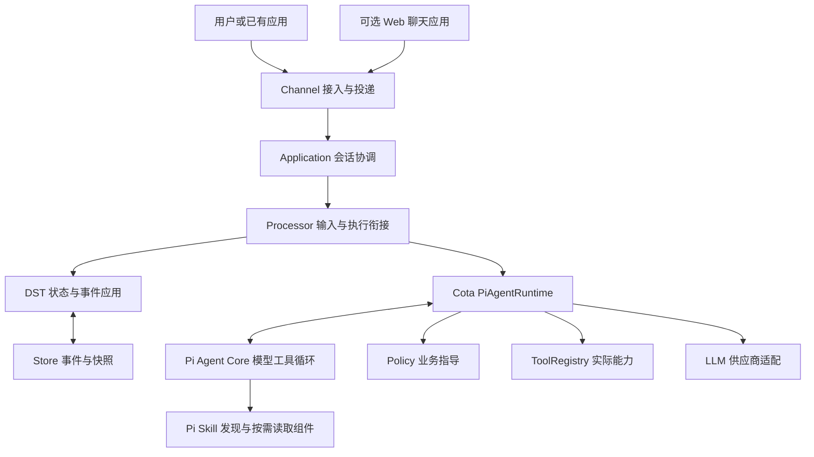

# 定位与架构

Cota 的定位是 **Bot 开发与部署平台**：让开发者用较少的 Agent 工程知识定义一个有业务能力、有行为规则、可部署和可分享的 Bot，并能根据真实执行记录持续改进它。

个人助手、客服和群聊助手是应用场景。框架的稳定职责是 Bot 定义、业务指导、执行证据、状态持久化与应用接入，而不是某一种聊天产品界面。

## 为什么以 Bot 交付

Skill 描述“怎样完成某类任务”，但一个可供他人使用的服务还需要角色、模型、实际工具、权限、存储、身份和投递。Cota 将这些组织成 Bot：

```text
Bot 定义：agent.yml + skills/ + policy/ + 可选 models/
部署资源：endpoints.yml + 工具依赖 + 持久化存储
使用入口：shell / Web / 飞书 / 自己的应用
```

分享已运行服务时，服务维护者负责环境、凭据、存储、升级和可用性；使用者拿到聊天入口。
分享 Bot 文件夹时，接收方承担部署维护，并配置自己的凭据和依赖。
当前没有自动打包全部依赖的 sandbox，也没有托管所有 Bot 的云平台。详见 [交付与分享](../deployment/sharing.md)。

## 模块边界



| 层 | 负责 | 边界 |
| --- | --- | --- |
| Bot 定义 | 角色、场景、Skill、工具范围、Policy | 文件存在不代表依赖已安装 |
| Pi 执行 | 模型决策、工具调用、多步循环 | 不持久保存 Cota 会话，不管理应用身份 |
| Cota Runtime | 准备 prompt、调用 Policy、适配模型/工具、确认事件已保存 | 不另写一套决定 Skill 顺序的循环 |
| DST / Store | 事件应用、状态恢复、历史、Trace、诊断与投递记录 | 不承担账号或群成员系统 |
| Application | 输入去重、同会话顺序、跨会话并发、群聊响应协调 | 当前没有分布式执行租约或持久任务队列 |
| Channel | 协议、可信身份映射、收发 | 不组织模型上下文，不决定业务 SOP |
| 外围应用 | 登录、会话归属、群成员、会话列表和 UI | 可使用独立的配套 Web app，也可自行实现 |

具体类与目录见 [模块地图](modules.md)。

## Skill → Trace → Policy 的业务闭环

- Skill 用稳定名称定义能力；模型可读取一个或多个 Skill，再使用实际工具。
- Trace 展示真实调用、参数、结果和回复。`active_skill` 只是最近成功读取的标签，不是排他流程状态。
- 运营直接编写对话式 Policy，或修改真实对话导出的草稿；不用手写原始 Event。
- Policy 的训练可以是建索引、计算向量或准备模型搜索语料；推理时根据当前对话提供有界业务指导。
- 每次 Pi 请求模型前都可重新选择指导，因此同一套案例能影响能力选择、执行结果分支和最终话术。

这是一套可观察、可验证的业务改进机制。Policy 是指导，不是确定性的流程引擎；事实和权限仍由真实上下文、工具与应用契约决定。自动生成改动、评估并应用 Bot 新版本的 RSI 尚未实现。

## 持久化统一，部署后端可选

本地个人 Bot 与多人服务使用同一套事件语义：正常运行与重放共用 DST 的 `apply_event()`。
SQLStore 按事件逐行追加保存，Snapshot 缓存某个序号的状态以加速恢复；运行需要的是状态和模型上下文投影，不是把整段对话当作一条不断覆盖的 JSON。

本地默认模板使用 SQLite；多人服务可按需要选择 MySQL/PostgreSQL 等 SQL 后端；单测使用 MemoryStore。
替换后端不改变 Skill、Policy 或 Channel 的业务含义。账号/成员信息属于外围应用，Debug 模型请求是独立诊断，不参与状态恢复。

## 场景差异放在哪里

`agent.yml` 的 `dialogue.mode` 固定部署为 direct 或 group；群聊的 response 可为 passive 或 proactive。
单聊保留普通消息格式；群聊为用户消息增加成员身份和 @/引用上下文。普通群消息可以只记录而不调用 Pi。

已有平台提供自己的账号与群成员体系；Cota 适配其身份和消息。
自建 Web 聊天应用需要成员与会话管理，可用 `cota/webapp` 的基础实现，也可以接入自己的系统。
不要把聊天室、成员管理塞进 WebSocket transport 或 DST。
